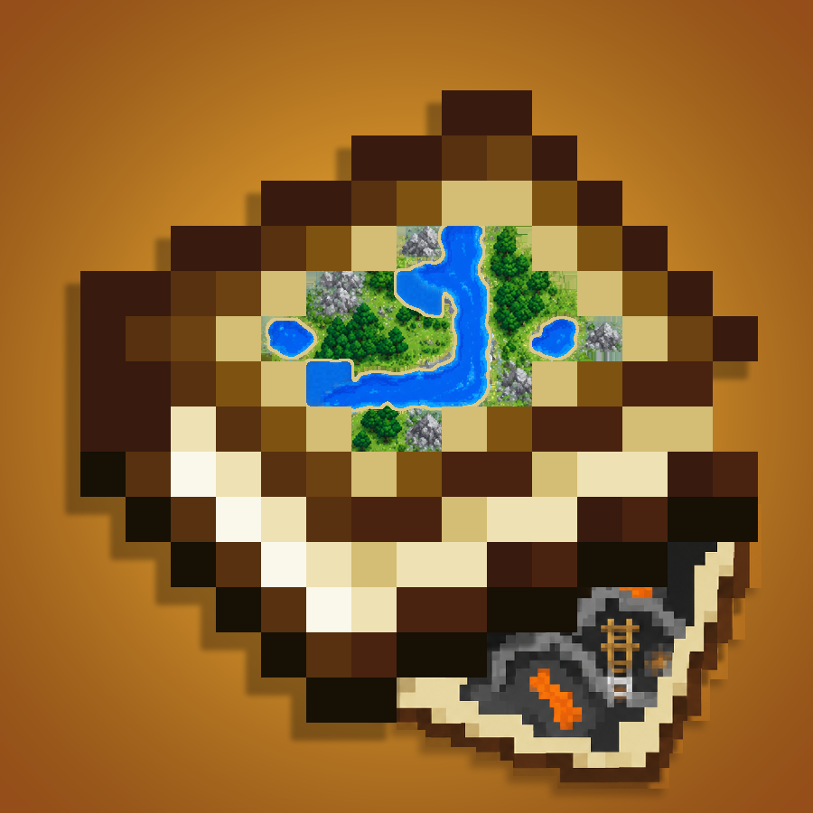

# Better Map Atlases

**Keep a record of the places you explore—above ground and below.**

Better Map Atlases is a Forge add-on for [Map Atlases](https://modrinth.com/mod/map-atlases-forge). It adds separate cave pages to your atlas, improves map colours using block textures and biome information, and makes the full-screen atlas and HUD easier to read and customise.

Underground maps grow as you explore: nearby floors you can actually see become part of the book's history. Mines, narrow tunnels, broad chambers, slopes, and the Nether use the same cave view. It does not reveal unexplored terrain or provide X-ray vision. Your records stay with the map pages and atlas, so carrying the book matters.

## What it adds

- **Surface and cave pages:** browse each dimension's surface or select **Cave** to see its explored underground history.
- **Height-aware cave maps:** follow the floor under your feet, including half-block heights, or use **Page Up / Page Down** to browse recorded heights one block at a time. Nearby slopes and steps provide route context; stacked floors remain distinct where a recorded solid ceiling separates them. Distant heights fade, and water and lava show their visible surfaces. These are navigation clues from observations, not guaranteed paths.
- **One cave page across heights:** a region's cave history uses one blank map across all Y levels; its surface uses a separate map. Revisiting the region updates those pages instead of spending a new map at each height.
- **Consistent large map and HUD:** both display the same recorded terrain. Zooming and panning change your view; they do not explore new ground.
- **Readable, adjustable controls:** change HUD size, zoom, orientation, position, map-marker size, player-pointer size, coordinate/biome text size, and internal map-page borders. Unknown areas remain blank paper.
- **Book-based markers and editing:** place a pin using a banner's colour and name; remove markers or cut pages with shears. Add blank maps to an existing atlas at a cartography table.
- **Dimension navigation:** Overworld/Nether browsing uses their 8:1 coordinate relationship. Other dimensions use explicitly configured links, or open at the origin when unlinked. Returning to your current dimension resumes following your position.
- **English and Simplified Chinese controls.**

## Install 1.0.0

The release targets **Minecraft 1.20.1**, **Forge 47.4.23**, and **Java 17**. Install Better Map Atlases on **both the client and server**, with these separately installed dependencies:

| Required mod | Version |
| --- | --- |
| Map Atlases | `1.20-6.0.20` |
| Moonlight Lib | `1.20-2.16.35-forge` |

Use the release JAR in the instance's `mods` folder. For an upgrade, replace the previous Better Map Atlases JAR and update all clients and the server together. Back up your world before changing its mod set.

[Download 1.0.0](https://github.com/nivpisum/better_map_atlases/releases/tag/v1.0.0) · [中文项目页](https://mc.nivpisum.com/project/better_map_atlases/)

**Better Nether Map `1.2-1.20.1` is optional:** existing fixed Nether map pages remain available with it installed. The cave survey works without it.

Two known compatibility settings:

- With **ImmediatelyFast**, set `map_atlas_generation=false` in its configuration.
- With **C2ME**, turn off **Map Atlases' multithreading**.

These settings address known interactions; compatibility with other mod combinations depends on the pack.

## First trip

1. Carry an atlas stocked with blank maps, then explore.
2. Open the atlas and select a dimension tab for its surface, or the deepslate **Cave** bookmark for its cave records.
3. On Cave, press **Page Up / Page Down** to inspect another height. Click **Cave** again to follow the floor under your feet. The bottom coordinate row shows the cursor's X/Z and the height you are viewing.
4. Use the settings button below the pin and shears to adjust the display. The full-screen atlas and HUD have separate viewing controls.
5. Carry banners for pins and shears for editing. A successful pin uses one banner; cutting a page or removing a marker uses one point of shears durability. Creative mode preserves these materials.

## 中文速览

Better Map Atlases 为地图册添加独立洞穴页，并改善地图颜色、大小地图显示与操作。洞穴记录来自你实际探索时看到的附近地面，不会揭示未探索地下；记录随地图页和书保存。

- 客户端与服务端都需安装。目标环境为 Minecraft **1.20.1**、Forge **47.4.23**、Java **17**；依赖 Map Atlases **1.20-6.0.20** 和 Moonlight Lib **1.20-2.16.35-forge**。
- 携带地图册和空白地图探索；地表与洞穴分别用图，同一区域的各个洞穴高度共用一张地图。
- 点维度标签看地表，点深板岩“洞穴”标签看地下。**PgUp / PgDn** 每次调整一格，再点“洞穴”恢复跟随脚下高度。
- 设置按钮位于图钉、剪刀下方；可调整大小、缩放、朝向、位置、标记、指针、文字与地图页边框。
- 旗帜用于放置带颜色和名称的标记，剪刀用于删标记或剪页；为已有地图册补图请用制图台。
- ImmediatelyFast 需设置 `map_atlas_generation=false`；使用 C2ME 时关闭 Map Atlases 多线程。Better Nether Map 为可选项。

## Source, licence, and credits

Build with JDK 17 using `./gradlew build` (`gradlew.bat build` on Windows). Required mods are obtained separately and are not bundled.

The source is licensed under [MPL-2.0](LICENSE). The logo is a GPL-3.0-only
derivative of the Map Atlases icon. See [NOTICE.md](NOTICE.md) and
[logo sources](branding/README.md) for attribution and asset terms.

Project design and direction are by **nivpisum**. AI assistance contributed substantially to the code and documentation. Better Map Atlases is an independent add-on, not an official release of Map Atlases, Accurate Maps, or Color Accurate Maps, and is not approved by or associated with Mojang or Microsoft.
